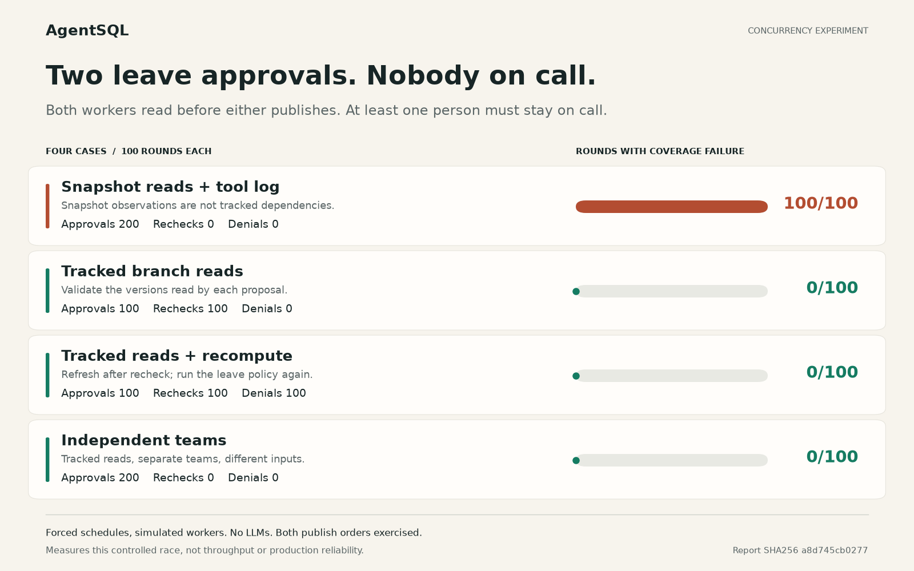

# On-call race: audit history and tracked reads

Two workers can make individually plausible decisions, update different keys,
and leave an invalid shared state. This lab models two responders, Alice and
Bob, who each want to leave. The application rule is that at least one
responder in each team must remain on call.

Both workers prepare against the same accepted revision. Each sees another
responder on call and proposes changing only its own status. These writes do
not overlap. The comparison asks whether the observations used to make those
decisions are validated when the proposals are accepted.

The lab uses the published AgentSQL `0.3.0a1` SDK with no runtime API changes.
The workers are real local Python processes; their decisions are simulated.
There is no language model, network request, API key, model-quality evaluation,
or claim of deterministic model replay.

## Run it

From a checkout of this repository, with Python 3.10 or later on macOS or Linux:

```sh
python3 -m venv .venv
. .venv/bin/activate
python -m pip install agentsql==0.3.0a1
python examples/on_call_race.py --rounds 10 --output on-call-results.json
```

The script lives in this checkout and imports the installed SDK. Use a fresh
output path for each run: an existing file or symlink is refused before the
experiment starts. The full JSON report is also printed to stdout.

`--rounds N` runs N trials per case, for four cases in total. The default is 10,
and the supported range is 1 through 100. Trials alternate Alice-first and
Bob-first acceptance; an even N balances those orders. The JSON report records
the schedules, decisions, tracked inputs, acceptance outcomes, and invariant
checks. Inspect it alongside the
[experiment source](../../examples/on_call_race.py).

## What changes between cases

| Case | Input observations | Application behavior being checked |
| --- | --- | --- |
| Snapshot reads with tool history | Read a snapshot pinned to the branch's base revision and explicitly log the observations | Logging does not register branch read dependencies; disjoint writes alone cannot protect the shared rule |
| Tracked branch reads | Read the same values through the branch and log the observations | Acceptance checks the versions used by the policy; the stale proposal requires a recheck |
| Tracked reads with recomputation | Repeat the tracked case, then prepare a new decision from current state | A fresh computation can decide to stay on call and publish that decision |
| Independent teams | Use tracked reads for workers whose teams share no roster keys | Unrelated work can both accept without a global revision-change rejection |

The snapshot baseline deliberately uses an inspection API as a computation
input without registering its dependencies. This is a misuse control, not a
different SQLite isolation setting or a disabled AgentSQL validator. Snapshot
reads remain coherent and immutable, but they are not attached to a branch's
read set. Tool history explicitly records the observations in this baseline;
it does not convert them into tracked reads.

The tracked comparison uses the same policy, initial values, tool logging, and
proposed changes. Each worker reads before staging its decision. A barrier
ensures both proposals are prepared before either is accepted, and the lab
exercises both acceptance orders. SQLite serializes the acceptance writes in
all cases; the important difference is whether input versions are validated.

This does not compare against a coordinator that holds an application lock
across the entire read, compute, and write operation. Such serialization is a
different design. The experiment prepares work in parallel and asks what an
acceptance-time check must validate after that preparation.

## Recorded run: 2026-10-30

The [frozen JSON report](results-2026-10-30.json) contains 100 trials per case,
400 trials in total, with two spawned worker processes per trial. Every case
ran 50 Alice-first and 50 Bob-first acceptance schedules. These are forced
interleavings, not random samples of production traffic.

| Case | Accepted proposals | Approved departures | Accepted denials | Rechecks | Trials with no on-call coverage |
| --- | ---: | ---: | ---: | ---: | ---: |
| Snapshot reads with tool history | 200 | 200 | 0 | 0 | 100 / 100 |
| Tracked branch reads | 100 | 100 | 0 | 100 | 0 / 100 |
| Tracked reads with recomputation | 200 | 100 | 100 | 100 | 0 / 100 |
| Independent teams | 200 | 200 | 0 | 0 | 0 / 100 |

The recomputation case made 100 fresh attempts, each publishing a denial after
reading the updated roster. The oracle found no incomplete publications in any
case. It checked all 400 seeded rosters and all 700 accepted decision revisions.
The snapshot baseline's coverage failures are the expected negative-control
outcome; they do not make its tool history disappear.



This run used AgentSQL `0.3.0a1`, Python 3.14.3, macOS 15.8.1, SQLite 3.53.4,
and the multiprocessing `spawn` start method. The report includes the SDK base
commit, experiment source hash, raw-report hash, and invocation. The report's
SHA256 is `a8d745cb0277c67cb880fdff710f9794af287d13c1de1dbc518311d9efbfb6a9`.
To repeat the same trial count with a fresh destination:

```sh
python examples/on_call_race.py --rounds 100 --output my-100-rounds.json
```

## How to interpret the evidence

The oracle checks the seeded roster and every accepted decision revision,
rather than only the final state.
The lab also checks that rejecting a proposal leaves its complete file and
state change set unpublished. The first worker's accepted change remains
visible, the rejected attempt remains inspectable, and tool-call evidence is
retained independently of acceptance.

In the recomputation case, the losing worker starts a fresh branch and reads
the current roster. The application can then decide that it must stay. That
new decision can be accepted even though the requested departure is refused.
An accepted proposal means that its state changes passed the SDK's dependency
and write checks; it is not approval for a person to leave.

The independent-team control is important: input validation should not reject
work merely because some unrelated accepted revision was created. It checks
that the lab's successful protection does not come from rejecting every second
publisher.

In `summary`, `requests` counts the two original departure requests per trial,
and `accepted_proposals` counts successfully published worker change sets.
`accepted_approvals` and `accepted_denials` distinguish the policy's two possible
decisions. `rechecks` counts stale proposals rejected by the SDK, while
`recomputations` counts fresh attempts. `coverage_violations` counts trials with
at least one invalid accepted decision revision. The oracle also checks for
incomplete publication, which must remain zero for a successful lab run. A top-level
`status` of `PASS` means that the expected outcomes of all cases were observed,
including the deliberately unsafe snapshot baseline.

## Scope

This experiment checks one explicit rule, a fixed roster, and controlled local
schedules. The application defines the policy and supplies every relevant
tracked read. AgentSQL does not discover arbitrary business invariants, judge
the policy, or infer missing dependencies from tool logs. Changing the roster
membership would require tracking that membership as well.

The lab does not measure throughput, production error rates, model correctness,
remote consistency, or recovery from external side effects. It does not make
the command runner a security sandbox. For deployment constraints, see the
[operations guide](../../docs/operations.md); for proposed next experiments, see
the [development guide](../../docs/development.md).
